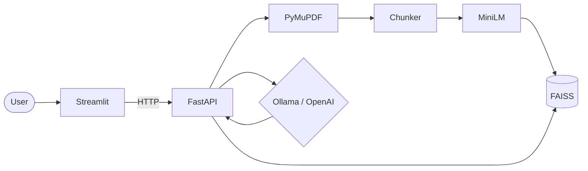

# AI PDF Assistant

> Grounded question answering over PDF documents with Retrieval-Augmented Generation (RAG).

**Local-first:** Ollama by default · Optional OpenAI · Streamlit UI + FastAPI · Docker Compose + CI  
**Not production-hosted:** no authentication — do not expose sensitive PDFs or Ollama publicly.

[Architecture](docs/ARCHITECTURE.md) · [Docs index](docs/README.md) · [Retrieval eval (Phase 5)](docs/PHASE5_VALIDATION_REPORT.md) · [Docker / CI (Phase 6)](docs/PHASE6_DEPLOYMENT_REPORT.md)

---

## Overview

AI PDF Assistant turns text-based PDFs into a searchable knowledge base. It extracts text, embeds chunks with MiniLM, indexes them in FAISS, retrieves relevant context for a question, and generates an answer **only from that context** (via **Ollama** or **OpenAI**). When evidence is weak, the API returns `insufficient_evidence` instead of guessing.

Built as a portfolio-ready end-to-end RAG demo: ingest → retrieve → generate, with citations, tests, and local packaging.

---

## Problem

- Keyword search over PDFs misses paraphrases and multi-page facts.
- Chatbots without retrieval invent details and lack page-level provenance.
- Teams often want a **local LLM path** for demos, plus an optional paid cloud model, without rewriting the app.

## Solution

A modular RAG stack with:

1. **Ingest** — validate PDF → PyMuPDF extract → recursive chunk → MiniLM embed → FAISS  
2. **Retrieve** — cosine similarity (threshold **0.18**) plus overview-aware paths for topic/summary questions  
3. **Generate** — grounded prompt to Ollama (`qwen3:0.6b` default) or OpenAI (`gpt-4o-mini`); env-only provider switch; **no silent fallback**

Use the Streamlit chat UI or the FastAPI/Swagger API.

---

## Features

- Upload and index text PDFs (size limit, MIME checks; no OCR)
- Semantic search without an LLM (`POST /search`)
- Grounded answers with filename + page + excerpt citations (`POST /ask`)
- Overview-aware retrieval for “What is the topic…?” / “Summarize…” style questions
- Document scoping (one PDF or all indexed docs)
- Streamlit UI (upload, select, chat) + interactive Swagger docs
- `LLM_PROVIDER=ollama` (default) or `openai`
- Docker Compose local demo; GitHub Actions runs mocked tests and builds images (**does not deploy**)

---

## Tech stack

| Layer | Choice |
|-------|--------|
| UI | Streamlit |
| API | FastAPI, Uvicorn, pydantic-settings |
| PDF | PyMuPDF |
| Chunking | LangChain recursive text splitter |
| Embeddings | Sentence Transformers `all-MiniLM-L6-v2` |
| Vector index | FAISS (local, persisted) |
| LLM | Ollama (default) or OpenAI |

---

## Architecture



Full ingestion and Q&A diagrams: **[`docs/ARCHITECTURE.md`](docs/ARCHITECTURE.md)**.

**Similarity vs overview:** FAISS hits keep real cosine scores (`retrieval="similarity"`). Topic/summary overview hits are leading document-ordered chunks (`retrieval="overview"`) — **not** a fake similarity of 1.0. The UI labels them **Document overview**.

---

## Quickstart (Ollama — default)

Requires **Python 3.11+** (developed on 3.12) and [Ollama](https://ollama.com/) on **localhost only**.

```bash
git clone https://github.com/SnigdhaJanmanchi/RAG-Based-PDF-Question-Answering-System.git
cd RAG-Based-PDF-Question-Answering-System

python -m venv .venv
source .venv/bin/activate   # Windows: .venv\Scripts\activate

pip install -r requirements.txt
cp .env.example .env
# Defaults: LLM_PROVIDER=ollama, OLLAMA_MODEL=qwen3:0.6b

ollama serve                # if not already running
ollama pull qwen3:0.6b
```

**Terminal A — API**

```bash
uvicorn app.main:app --reload --port 8000
```

- Health: http://localhost:8000/health  
- Swagger: http://localhost:8000/docs  

**Terminal B — UI**

```bash
export API_BASE_URL=http://localhost:8000   # optional; this is the default
streamlit run frontend/streamlit_app.py
```

Open the URL Streamlit prints (usually http://localhost:8501). Upload a PDF, select a document (or all), then ask a question.

First embedding/upload downloads the Sentence Transformers model (one-time; hundreds of MB with PyTorch).

Provider switching is **env-only**. There is **no** silent fallback from Ollama → OpenAI (or the reverse).

---

## Optional OpenAI

```bash
# In .env
LLM_PROVIDER=openai
OPENAI_API_KEY=sk-...
OPENAI_MODEL=gpt-4o-mini
```

Restart the API after changing env. OpenAI usage incurs API cost. Live OpenAI E2E tests are optional and skip when no key is set.

---

## Docker Compose

**Warning:** no authentication. Do not put sensitive PDFs on a public host. Do not expose Ollama beyond localhost.

```bash
cp .env.example .env
# Prefer host uvicorn + host Ollama for the simplest local LLM path.
# For OpenAI in Compose: LLM_PROVIDER=openai and set OPENAI_API_KEY.

docker compose build
docker compose up -d
```

| Service | URL |
|---------|-----|
| API health | http://localhost:8000/health |
| Swagger | http://localhost:8000/docs |
| Streamlit | http://localhost:8501 |

Uploads and FAISS indexes persist in the `app_data` volume. The API image bakes MiniLM and uses **CPU-only** PyTorch (API image ≈ **2.6 GB**).

More detail: [`docs/PHASE6_DEPLOYMENT_REPORT.md`](docs/PHASE6_DEPLOYMENT_REPORT.md).

---

## Example API

```bash
# Health
curl -s http://localhost:8000/health

# Upload
curl -s -F "file=@tests/fixtures/sample.pdf" \
  http://localhost:8000/documents/upload

# Semantic search (no LLM)
curl -s -X POST http://localhost:8000/search \
  -H "Content-Type: application/json" \
  -d '{"query":"Where does the indigo phoenix nest?","top_k":5}'

# Grounded ask (uses LLM_PROVIDER)
curl -s -X POST http://localhost:8000/ask \
  -H "Content-Type: application/json" \
  -d '{"question":"Where does the indigo phoenix nest?","document_id":null,"top_k":5}'
```

| Method | Path | Purpose |
|--------|------|---------|
| `GET` | `/health` | Liveness |
| `POST` | `/documents/upload` | Upload PDF → index |
| `POST` | `/upload` | Alias for upload |
| `GET` | `/documents` | List indexed documents |
| `POST` | `/search` | Semantic search (no LLM) |
| `POST` | `/ask` | Grounded RAG answer |

`/ask` responses include `answer`, `status` (`ok` | `insufficient_evidence`), `sources` (filename, page, excerpt, score, `retrieval`), and `documents`. There is **no** delete-document route yet.

Configuration reference: [`.env.example`](.env.example) (chunk size, `TOP_K`, `SIMILARITY_THRESHOLD=0.18`, overview knobs, timeouts, etc.). Never commit `.env`, uploads, or FAISS indexes. The Streamlit app never reads LLM secrets — only the API does.

---

## Evaluation

Offline **retrieval** evaluation on a labeled fixture set (no LLM):

```bash
python scripts/eval_retrieval.py --k 3
```

| Metric | Value | Source |
|--------|-------|--------|
| **Hit@3** | **1.000** (10/10) | [`docs/PHASE5_VALIDATION_REPORT.md`](docs/PHASE5_VALIDATION_REPORT.md) |
| **Mean Recall@3** | **1.000** | same report · dataset `tests/fixtures/retrieval_dataset.json` |

These are **small-sample retrieval metrics** on 10 labeled questions. They measure whether the right pages appear in the top-3 chunks — **not** end-to-end answer accuracy, groundedness of generated text, or production quality.

### Tests

```bash
pytest -m "not live and not live_ollama"   # mocked suite (CI)
pytest -m live                             # optional live OpenAI
pytest -m live_ollama                      # optional live Ollama
```

CI (`.github/workflows/ci.yml`) runs the mocked suite and builds both Docker images with `push: false` — **it does not deploy**.

---

## Screenshots / demo

Screenshots and a short demo video are **not checked in yet**. Capture later against a real local run (do not invent placeholders as image files):

| Suggested asset | Show |
|-----------------|------|
| Streamlit upload + document list | After indexing `tests/fixtures/sample.pdf` |
| Chat answer + similarity citations | e.g. “Where does the indigo phoenix nest?” |
| Overview citation label | Topic question on `abstract_drone.pdf` → **Document overview** |
| Swagger `POST /ask` | Try-it response in `/docs` |
| Compose healthy | API + UI up after `docker compose up` |

Suggested 60–90s narrative: problem → architecture strip → phoenix Q&A with citation → overview label → Hit@3 note → “local demo, no auth.” Full capture checklist: [`docs/PORTFOLIO_IMPROVEMENT_PLAN.md`](docs/PORTFOLIO_IMPROVEMENT_PLAN.md) §5.

---

## Limitations

- **Citations do not prove correctness** — always verify against the PDF pages.
- Prompts reduce but do not eliminate hallucinations.
- **No OCR**; encrypted PDFs rejected; local FAISS only.
- No document delete API/UI yet.
- **No authentication** — unsuitable for public sensitive documents.
- API Docker image is multi-GB (~2.6 GB with CPU PyTorch + MiniLM).
- Small local models (e.g. `qwen3:0.6b`) are weaker than paid OpenAI models.
- Ollama must stay on localhost (non-loopback `OLLAMA_BASE_URL` is refused).
- Live OpenAI ask and interactive browser QA may be unverified in a given environment — see validation reports.
- CI builds images but does **not** auto-deploy.

---

## Troubleshooting

| Symptom | What to check |
|---------|----------------|
| Streamlit: “Cannot reach the API” | Is `uvicorn` running? Is `API_BASE_URL` correct? |
| Upload fails / OCR message | Text-based PDFs only; scanned PDFs need OCR (not supported) |
| Ask returns 503 about API key | Only when `LLM_PROVIDER=openai` — set `OPENAI_API_KEY`, restart API |
| Ask fails talking to Ollama | Is `ollama serve` on localhost? Is `OLLAMA_MODEL` pulled? No OpenAI fallback |
| Empty / insufficient evidence | Try another question, confirm the PDF is indexed, or review threshold settings in `.env.example` |
| Duplicate upload notices | Expected — identical content is detected by hash |

---

## Project layout

```text
app/                 # FastAPI backend (ingest, FAISS, RAG, LLM providers)
frontend/            # Streamlit UI
docs/                # Architecture, validation reports, portfolio plan
tests/               # Fixtures + unit/integration tests
scripts/             # Offline retrieval eval
Dockerfile.api / Dockerfile.ui
docker-compose.yml
.github/workflows/ci.yml
```

---

## GitHub About (manual)

Apply in the repository **About** settings (not set by this docs PR):

**Description:**

> Local-first RAG app for grounded Q&A over PDFs: Streamlit + FastAPI, PyMuPDF, MiniLM embeddings, FAISS, and Ollama (default) or OpenAI. Docker Compose + CI. No auth — demo use only.

**Topics:** `rag` · `fastapi` · `streamlit` · `faiss` · `sentence-transformers` · `pymupdf` · `ollama` · `openai` · `pdf` · `docker` · `python`
