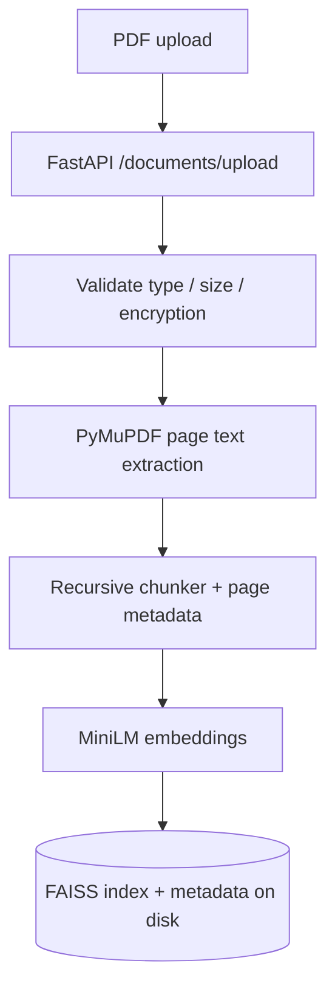
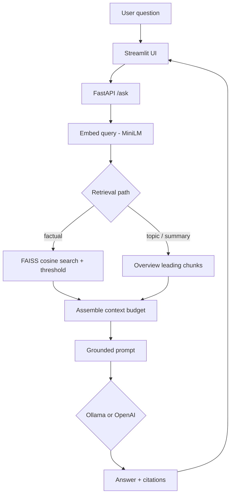

# Architecture — AI PDF Assistant

This document describes the runtime architecture of the local RAG MVP on `main`.  
Implementation modules live under `app/services/` and `frontend/`.

**Related:** [README](../README.md) · [Phase 5 validation](PHASE5_VALIDATION_REPORT.md) · [Phase 6 packaging](PHASE6_DEPLOYMENT_REPORT.md)

---

## System context

| Component | Role |
|-----------|------|
| **Streamlit** (`frontend/streamlit_app.py`) | Upload, document select, chat UI; talks to the API over HTTP |
| **FastAPI** (`app/main.py`, `app/api/routes.py`) | Ingest, search, grounded `/ask`; owns secrets and LLM calls |
| **PyMuPDF** | Page-wise text extraction |
| **Chunker** | Recursive character splitting with page metadata |
| **MiniLM** (`all-MiniLM-L6-v2`) | Local embeddings (dim 384) |
| **FAISS** | Persisted vector index + chunk metadata under `data/` |
| **Ollama / OpenAI** | Generation only; selected by `LLM_PROVIDER` (env switch, no silent fallback) |

Secrets (`OPENAI_API_KEY`, etc.) are read **only** by the API process. Ollama is restricted to loopback URLs.

---

## 1. Ingestion pipeline

PDF bytes enter through FastAPI (`POST /documents/upload`). Text is extracted, chunked, embedded, and written to FAISS with sidecar metadata.



**Code map:** `pdf_parser.py` → `chunker.py` → `embeddings.py` → `vector_store.py` (orchestrated by `ingest.py`).

Identical content is detected by hash and reported as a duplicate without double-indexing.

---

## 2. Question-answering pipeline

The user asks a question in Streamlit (or via Swagger/`curl`). The API embeds the query, retrieves context from FAISS (similarity and/or overview paths), builds a grounded prompt, and calls the configured LLM.



**Code map:** `rag.py` + `overview.py` + `vector_store.py` + `app/services/llm/*`.

| Retrieval mode | When | Citation UI |
|----------------|------|-------------|
| `similarity` | Default factual questions; FAISS cosine ≥ `SIMILARITY_THRESHOLD` (default **0.18**) | Shows similarity score |
| `overview` | Topic/summary intent (and small-doc fallback); document-ordered leading chunks | Labeled **Document overview** — score is **not** a cosine of 1.0 |

If no usable context remains, the API returns `status=insufficient_evidence` without inventing an answer.

---

## Persistence

Runtime data (gitignored) under `DATA_DIR` (default `data/`):

- Uploaded PDF bytes  
- FAISS index files  
- Chunk / document metadata  

Docker Compose mounts this as the named volume `app_data`. The embedding model cache in the API image (`/app/model_cache`) must **not** be overwritten by that volume.

---

## Provider abstraction

```text
LLM_PROVIDER=ollama   → OllamaProvider (default; localhost only)
LLM_PROVIDER=openai   → OpenAIProvider (requires OPENAI_API_KEY)
```

Factory: `app/services/llm/factory.py`. Switching providers requires an env change and API restart — never a silent cross-provider retry.

---

## Security boundaries (honest)

- **No authentication** on API or UI  
- Do not expose the stack publicly with sensitive PDFs  
- Do not expose Ollama beyond localhost  
- Prompt wrapping treats PDF excerpts as untrusted data (reduces but does not eliminate injection / hallucination risk)  
- Citations show retrieved context; they do **not** prove answer correctness  

---

## Further reading

- Config defaults: [`.env.example`](../.env.example)  
- Retrieval Hit@K results: [PHASE5_VALIDATION_REPORT.md](PHASE5_VALIDATION_REPORT.md)  
- Docker / CI: [PHASE6_DEPLOYMENT_REPORT.md](PHASE6_DEPLOYMENT_REPORT.md)  
- Portfolio docs plan: [PORTFOLIO_IMPROVEMENT_PLAN.md](PORTFOLIO_IMPROVEMENT_PLAN.md)
