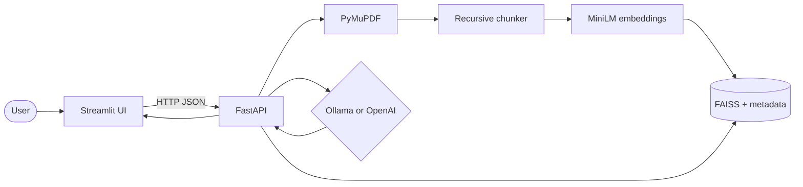
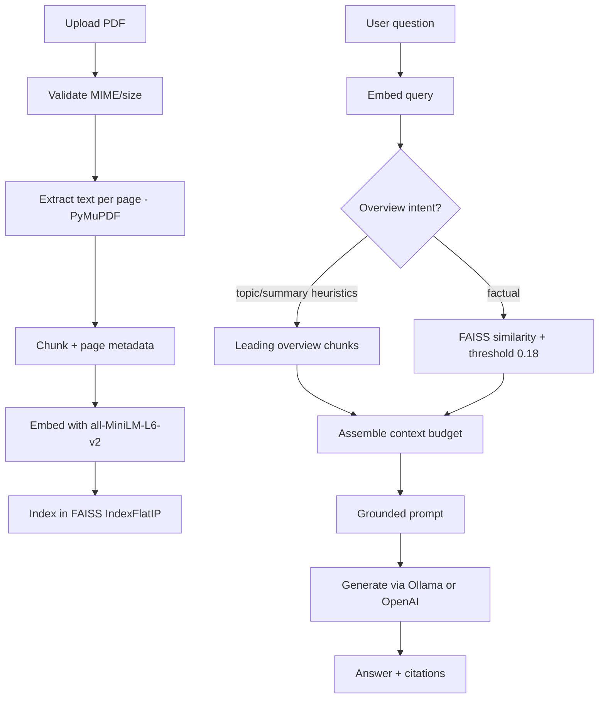

# Portfolio Improvement Plan — AI PDF Assistant

**Repo:** [SnigdhaJanmanchi/RAG-Based-PDF-Question-Answering-System](https://github.com/SnigdhaJanmanchi/RAG-Based-PDF-Question-Answering-System)  
**Baseline reviewed:** `main` @ `066a74d` (Phase 0–6 RAG MVP + Ollama + overview retrieval + Docker/CI)  
**Plan date:** 2026-11-06  
**Scope:** Documentation and GitHub presentation only. **No RAG code changes in this phase.**  
**Status:** Plan only — **awaiting approval before implementation.**

---

## 0. Executive recommendations (what to do first)

| Priority | Action | Why |
|----------|--------|-----|
| P0 | Rewrite README for portfolio readers (problem → solution → stack → quickstart → architecture link → eval → limitations) | Current README is accurate for maintainers but dense; status line is slightly stale (“Docker… remain” while Phase 6 is Done) |
| P0 | Add `docs/ARCHITECTURE.md` with Mermaid ingest/retrieve/generate diagrams | No architecture doc or diagram exists on `main` |
| P0 | Capture real screenshots + optional 60–90s demo (placeholders first) | Zero media in repo; portfolio readers need visual proof |
| P1 | Align GitHub About description + topics with Ollama + Streamlit + RAG | Description still OpenAI-centric; `repositoryTopics` is empty |
| P1 | Add thin `docs/README.md` index linking phase reports + architecture + eval | Validation reports exist but navigation is buried |
| P2 | Trim README config table (link to `.env.example`); keep API curl samples | Improves first-screen skim without losing honesty |
| — | **Do not** invent Hit@K / latency / accuracy numbers | Only publish metrics already recorded in Phase 5+ reports |
| — | **Do not** fabricate screenshots or claim production/auth/cloud deploy | Honesty is a portfolio strength |

**Out of scope for the approved implementation pass (unless explicitly requested later):** RAG algorithm changes, new eval datasets, cloud deploy, auth, OCR, delete API, merging unrelated feature work.

---

## 1. Baseline review (`main` @ `066a74d`)

### 1.1 What exists and works

| Area | Evidence on `main` |
|------|--------------------|
| FastAPI backend | `app/main.py`, `app/api/routes.py` — `/health`, upload, list, `/search`, `/ask` |
| PDF ingest | PyMuPDF (`pdf_parser.py`) → recursive chunker → MiniLM embeddings → FAISS (`vector_store.py`) |
| RAG generate | `rag.py` + LLM factory: **Ollama default** (`qwen3:0.6b`) or OpenAI (`gpt-4o-mini`); no silent fallback |
| Overview retrieval | Topic/summary path + `SIMILARITY_THRESHOLD=0.18`; citations label `similarity` vs `overview` |
| Streamlit UI | Upload, doc select, chat, citations (`frontend/streamlit_app.py`) |
| Docker + CI | `Dockerfile.api` / `Dockerfile.ui`, `docker-compose.yml`, `.github/workflows/ci.yml` (test + build, **no deploy**) |
| Validation docs | `docs/PHASE5_VALIDATION_REPORT.md`, `PHASE6_DEPLOYMENT_REPORT.md`, `FINAL_RELEASE_VALIDATION.md` |
| Offline retrieval eval | `scripts/eval_retrieval.py` + `tests/fixtures/retrieval_dataset.json` (10 cases) |

### 1.2 Portfolio gaps (docs/presentation only)

| Gap | Current state |
|-----|---------------|
| Problem / audience framing | README opens with status + stack; little “why this exists” |
| Architecture diagram | None (no Mermaid / image) |
| Screenshots / demo | None in tree |
| Dedicated architecture doc | Only phase validation reports |
| Evaluation surface | Hit@K buried in Phase 5 report; README mentions the command but not the numbers |
| GitHub About | Description mentions OpenAI only; omits Ollama, Streamlit, Docker; topics unset |
| README status consistency | Line 5 still says “Docker Compose packaging + CI remain” while the status table marks Phase 6 **Done** |
| Doc navigation | No `docs/` index; three long validation reports without a map |
| Example API | JSON body only — no `curl` end-to-end sample |

### 1.3 Implementation / test posture (for accurate claims)

**Do cite:**

- Offline retrieval: **Hit@3 = 1.000**, **Mean Recall@3 = 1.000** on **10** labeled cases (`docs/PHASE5_VALIDATION_REPORT.md`, dataset `tests/fixtures/retrieval_dataset.json`).
- Automated mocked suite grew after Ollama + overview work; latest citation-polish report recorded **129 passed**, 3 deselected (`live` / `live_ollama`). Phase 5/final reports earlier recorded **77 passed** (pre-Ollama/overview growth) — when quoting, **name the report/date** so numbers are not mixed.
- Live Ollama `/ask` verified in overview work (Abstract Drone topic ask); live OpenAI and interactive browser walkthrough historically **unverified** in validation reports.
- API image ≈ **2.64 GB** (CPU PyTorch) after final release optimization; Compose health/upload/search/persistence verified.
- **No auth**, **not auto-deployed**, **not production-certified**.

**Do not invent:** end-to-end answer accuracy %, latency SLOs, production uptime, “beats GPT-4” style claims, or screenshot assets that were never captured.

---

## 2. Professional README plan

Target tone: **portfolio-first, engineer-honest** — scannable in 60 seconds, deep links for reviewers who dig in.

### 2.1 Proposed section outline (implementation order)

1. **Title + one-line tagline**  
   Keep “AI PDF Assistant”; tagline ≈ grounded Q&A over PDFs via RAG (local Ollama or OpenAI).

2. **Badges (optional, honest only)**  
   - CI status from GitHub Actions  
   - Python 3.11+  
   - License if/when added  
   - **No** fake “coverage %” or “accuracy” badges

3. **Overview (3–5 sentences)**  
   What it is, who it’s for (developers / interviewers exploring a full RAG stack), what “grounded” means (answer only from retrieved chunks; `insufficient_evidence` when weak).

4. **Problem**  
   - PDFs are hard to query with keyword search alone  
   - Naive LLM chat invents facts without citations  
   - Want a **local-first** path (Ollama) plus optional cloud LLM without rewriting the app

5. **Features** (bullets, not a phase checklist)  
   - Upload text PDFs → chunk → embed → FAISS index  
   - Semantic search (`POST /search`) without LLM  
   - Grounded ask (`POST /ask`) with page citations  
   - Overview-aware retrieval for topic/summary questions  
   - Streamlit chat UI + Swagger  
   - Provider switch: `LLM_PROVIDER=ollama|openai` (env-only)  
   - Docker Compose local demo + CI (tests + image builds)

6. **Tech stack** (compact table — keep current accuracy)  
   Streamlit · FastAPI · PyMuPDF · LangChain splitters · `all-MiniLM-L6-v2` · FAISS · Ollama / OpenAI

7. **Architecture / RAG workflow**  
   Short prose + link to `docs/ARCHITECTURE.md` + embed **one** Mermaid flowchart (see §3).

8. **Quickstart — Ollama (default)**  
   Clone → venv → `pip install` → `.env` → `ollama pull qwen3:0.6b` → uvicorn → Streamlit  
   Explicit: localhost-only Ollama; no silent OpenAI fallback.

9. **Optional OpenAI**  
   `LLM_PROVIDER=openai` + `OPENAI_API_KEY`; note cost and that live E2E may be environment-dependent.

10. **Docker Compose**  
    Keep warning: **no auth**; do not expose sensitive PDFs or Ollama publicly. Link Phase 6 report for hosting notes.

11. **Example API**  
    Add `curl` for health, upload, search, ask (see §2.2). Keep JSON schema summary.

12. **Screenshots / Demo** (placeholders until real assets)  
    See §5 — use `docs/media/` paths; caption what each image *will* show; never commit fake images.

13. **Evaluation + limitations**  
    Publish **only** existing Hit@3/Recall@3 + test posture + known limits (see §4). Link Phase 5/6/final reports.

14. **Project layout** (short tree) + **Configuration** (link `.env.example`; move long table out of hero README or collapse).

15. **Troubleshooting** — keep current table (high value for recruiters who clone).

16. **Remove / rewrite** the long “Current development status” phase matrix from the top — move a one-line “MVP complete (Phases 0–6)” into Overview; keep phase reports linked under docs.

### 2.2 Example API samples to add (copy targets)

```bash
# Health
curl -s http://localhost:8000/health

# Upload
curl -s -F "file=@tests/fixtures/sample.pdf" \
  http://localhost:8000/documents/upload

# Semantic search (no LLM)
curl -s -X POST http://localhost:8000/search \
  -H "Content-Type: application/json" \
  -d '{"query":"Where does the indigo phoenix nest?","top_k":5}'

# Grounded ask (Ollama or OpenAI depending on LLM_PROVIDER)
curl -s -X POST http://localhost:8000/ask \
  -H "Content-Type: application/json" \
  -d '{"question":"Where does the indigo phoenix nest?","document_id":null,"top_k":5}'
```

Document response fields already in README: `answer`, `status` (`ok` | `insufficient_evidence`), `sources[]` with `retrieval` = `similarity` | `overview`.

### 2.3 README copy constraints

- Fix stale “Docker… remain” wording.  
- Prefer product name **AI PDF Assistant**; repo folder name can stay.  
- Keep security honesty: no auth, citations ≠ correctness, no OCR, small local models weaker than paid OpenAI.  
- Do not claim cloud staging URL or production readiness.

---

## 3. Architecture docs plan

### 3.1 New file: `docs/ARCHITECTURE.md`

Suggested sections:

1. System context (UI ↔ API ↔ disk ↔ LLM)  
2. Ingest pipeline  
3. Retrieve + generate (including overview path)  
4. Persistence layout (`data/` uploads, FAISS, metadata)  
5. Provider abstraction (`LLM_PROVIDER`)  
6. Security boundaries (secrets only on API; Ollama loopback)  
7. Links to validation reports

### 3.2 Mermaid — system context (Streamlit → … → LLM)

Plan to include this diagram (or equivalent) in `ARCHITECTURE.md` and a simplified version in the README:



### 3.3 Mermaid — RAG stages (ingest / embed / retrieve / generate)



### 3.4 Implementation notes for diagrams

- Keep labels aligned with real modules: `pdf_parser`, `chunker`, `embeddings`, `vector_store`, `overview`, `rag`, `llm/*`.  
- Call out explicitly: overview hits are **not** cosine 1.0; UI shows “Document overview”.  
- Optional sequence diagram for `/ask` only if README stays short.

---

## 4. Evaluation section plan (accurate metrics only)

### 4.1 Retrieval metrics to publish (from Phase 5)

**Source of truth:** `docs/PHASE5_VALIDATION_REPORT.md` §3  
**Command:** `python scripts/eval_retrieval.py --k 3`  
**Dataset:** `tests/fixtures/retrieval_dataset.json` — **10** cases  
**Embeddings:** `sentence-transformers/all-MiniLM-L6-v2` (local, no LLM)

| Metric | Value | Notes |
|--------|-------|-------|
| Hit@3 | **1.000** (10/10) | Page hit among top-3 for labeled positives |
| Mean Recall@3 | **1.000** | As reported in Phase 5 |
| Soft negative | `absent-fact` | Success = does not invent CEO/salary content |

Per-case IDs (for optional appendix table — copy from Phase 5, do not re-score without re-running):  
`phoenix-nest`, `phoenix-year`, `warehouse-code`, `emergency-ext`, `courier`, `hazard-form`, `shelf-load`, `widget-location`, `otter`, `absent-fact`.

**README wording template:**

> Offline retrieval evaluation on 10 labeled fixture questions reports Hit@3 = 1.000 and mean Recall@3 = 1.000 (`scripts/eval_retrieval.py --k 3`). This measures **retrieval**, not end-to-end answer correctness.

### 4.2 Test coverage claims (cite reports; do not invent %)

| Claim | Safe wording |
|-------|----------------|
| Mocked CI suite | CI runs `pytest -m "not live and not live_ollama"`; builds API+UI images with `push: false` |
| Historical counts | Phase 5 / final release: **77 passed**, 1 deselected (`not live`). Post–Ollama/overview: reports cite **128–129 passed**, 3 deselected — quote the specific report when publishing |
| Live OpenAI | Optional `@pytest.mark.live`; **unverified** when key absent |
| Live Ollama | Optional `@pytest.mark.live_ollama`; verified in overview work for sample + Abstract Drone topic |
| Browser UI | Manual walkthrough historically **not performed** in agent validation — plan real screenshots in §5 instead of claiming it |

Do **not** publish a code-coverage percentage unless `coverage.py` is run and recorded in a future approved pass.

### 4.3 Known limitations to surface (from existing docs)

- No OCR; scanned/blank PDFs rejected with clear errors  
- No document DELETE API/UI  
- No auth / multi-tenant isolation — unsuitable for public sensitive docs  
- Hybrid BM25 not added (dense Hit@3 was 1.0 on this eval set)  
- Small local models (`qwen3:0.6b`) weaker than paid OpenAI  
- Citations show retrieved context; they do **not** prove answer correctness  
- API image still ~2.6 GB; CI does not deploy  
- Overview intent is heuristic (regex); unusual phrasings may miss  

---

## 5. Demo prep plan (no fabricated screenshots)

### 5.1 Screenshot list (capture after approval; store under `docs/media/`)

| # | Filename (proposed) | What to show | Why it helps |
|---|---------------------|--------------|--------------|
| 1 | `01-streamlit-upload.png` | Sidebar upload + document list after indexing `sample.pdf` | Proves ingest UX |
| 2 | `02-streamlit-ask-citations.png` | Chat answer to phoenix question + similarity citations | Core RAG value |
| 3 | `03-streamlit-overview-label.png` | Topic question with **Document overview** citation label | Shows overview path honesty |
| 4 | `04-swagger-ask.png` | Swagger `POST /ask` try-it response | API surface for backend reviewers |
| 5 | `05-compose-health.png` | Terminal or browser showing API+UI healthy after `docker compose up` | Packaging credibility |

Until captured, README should use a **placeholder section**:

```markdown
## Screenshots / demo

> Screenshots pending — run the local demo and drop PNGs into `docs/media/` using the names in `docs/PORTFOLIO_IMPROVEMENT_PLAN.md` §5.1.
```

**Rules:** real UI only; no stock mockups; no edited fake scores; prefer fixture PDFs (`sample.pdf`, `multipage_facts.pdf`, `abstract_drone.pdf`).

### 5.2 Short demo workflow (human or recording)

1. Start Ollama (`ollama serve`, model pulled) **or** set OpenAI env.  
2. `uvicorn app.main:app --port 8000` + `streamlit run frontend/streamlit_app.py` (or Compose).  
3. Upload `tests/fixtures/sample.pdf`.  
4. Ask: “Where does the indigo phoenix nest?” → expect Lake Azure + page citation.  
5. Upload `tests/fixtures/abstract_drone.pdf`, select it, ask: “What is the topic of this document?” → expect overview path / topic answer.  
6. Optional: show Swagger `/search` without LLM.  
7. Optional: stop API → show Streamlit error handling.

### 5.3 60–90 second script

| Time | Spoken / on-screen |
|------|--------------------|
| 0–10s | “AI PDF Assistant — ask questions over PDFs with grounded RAG. Local Ollama by default, OpenAI optional.” |
| 10–25s | Show stack strip or architecture diagram: Streamlit → FastAPI → PyMuPDF → MiniLM → FAISS → LLM. |
| 25–45s | Upload `sample.pdf`; ask phoenix question; highlight answer + **page citation**. |
| 45–65s | Topic question on Abstract Drone; point at **Document overview** label vs similarity score. |
| 65–80s | “Retrieval eval: Hit@3 and Recall@3 = 1.0 on 10 labeled cases.  Docker Compose + CI; no auth — local/portfolio demo.” |
| 80–90s | Close on GitHub link + “answers only from retrieved context.” |

Recording format: MP4 or GIF under `docs/media/demo-60s.mp4` (optional). Do not commit until a real capture exists.

---

## 6. GitHub presentation plan

### 6.1 About description (proposed)

> Local-first RAG app for grounded Q&A over PDFs: Streamlit + FastAPI, PyMuPDF, MiniLM embeddings, FAISS, and Ollama (default) or OpenAI. Docker Compose + CI. No auth — demo use only.

(Update via GitHub UI or `gh repo edit`; not a code change.)

### 6.2 Topics (proposed)

`rag` · `fastapi` · `streamlit` · `faiss` · `sentence-transformers` · `pymupdf` · `ollama` · `openai` · `pdf` · `docker` · `python`

### 6.3 Doc navigation

Add `docs/README.md` index:

```text
docs/
├── README.md                      # index (new)
├── ARCHITECTURE.md                # Mermaid + pipeline (new)
├── PORTFOLIO_IMPROVEMENT_PLAN.md  # this plan
├── PHASE5_VALIDATION_REPORT.md    # Hit@K + hardening
├── PHASE6_DEPLOYMENT_REPORT.md    # Docker / CI / hosting notes
├── FINAL_RELEASE_VALIDATION.md    # release posture
└── media/                         # screenshots / demo (new, after capture)
```

Root README links: Architecture · Evaluation (Phase 5) · Deployment (Phase 6) · Final validation · Screenshots.

### 6.4 Social preview / README hero

- Once screenshots exist, put #2 (ask + citations) near the top of the README.  
- Optional: set GitHub social preview image to the same asset (repo Settings → Social preview).

---

## 7. Implementation checklist (after approval only)

Docs-only PR(s) recommended; keep RAG code untouched.

| Step | Deliverable | Notes |
|------|-------------|-------|
| 1 | Rewrite root `README.md` per §2 | Fix stale status; add eval numbers; placeholders for media |
| 2 | Add `docs/ARCHITECTURE.md` + Mermaid | §3 |
| 3 | Add `docs/README.md` index | §6.3 |
| 4 | Create `docs/media/.gitkeep` + README placeholders | No fake PNGs |
| 5 | Capture screenshots / optional demo | Human or approved agent session with real UI |
| 6 | Update GitHub About + topics | Outside git if needed |
| 7 | Draft PR → review → merge when approved | Still no deploy / no RAG changes |

### 7.1 Explicit non-actions

- Do not modify retrieval thresholds, prompts, or providers under the guise of “portfolio polish.”  
- Do not invent benchmarks or regenerate Hit@K claims without re-running and recording.  
- Do not merge to `main` or deploy without explicit approval.  
- Do not expose Ollama beyond localhost in docs examples.

---

## 8. Success criteria

Portfolio docs are “done” when:

1. A new visitor understands **problem → RAG pipeline → how to run (Ollama) → how to evaluate** in one README pass.  
2. Architecture Mermaid matches the real Streamlit→FastAPI→PyMuPDF→MiniLM→FAISS→Ollama/OpenAI path.  
3. Evaluation section quotes **Hit@3/Recall@3 = 1.000 on 10 cases** with links to Phase 5 — nothing more fabricated.  
4. Screenshot section either has **real** PNGs or honest placeholders.  
5. GitHub About/topics reflect Ollama + Streamlit + RAG.  
6. Limitations remain visible and consistent with validation reports.

---

## 9. Stop point

This document is the **plan only**. Implementation (README rewrite, architecture doc, media capture, GitHub metadata) starts only after explicit approval.
